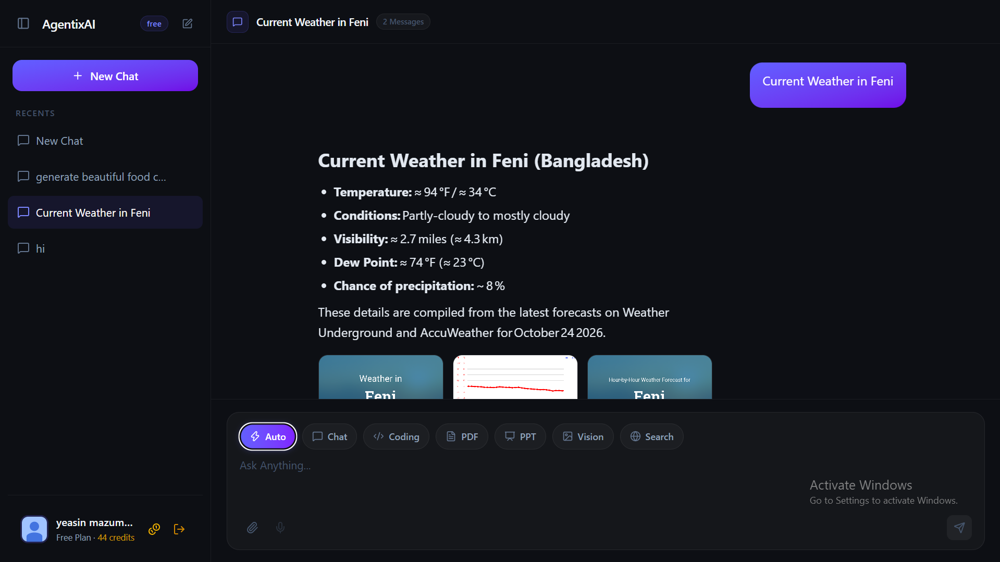
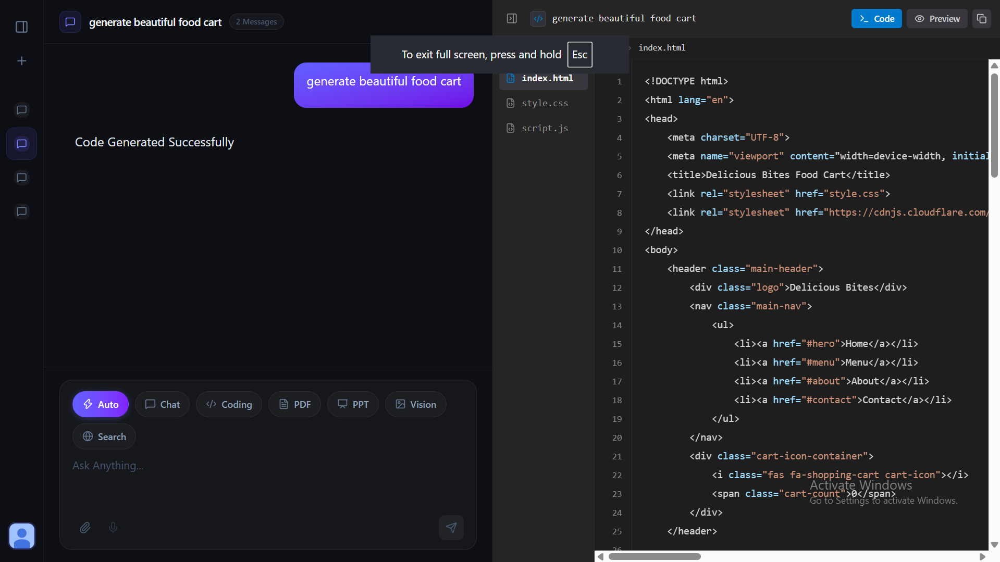
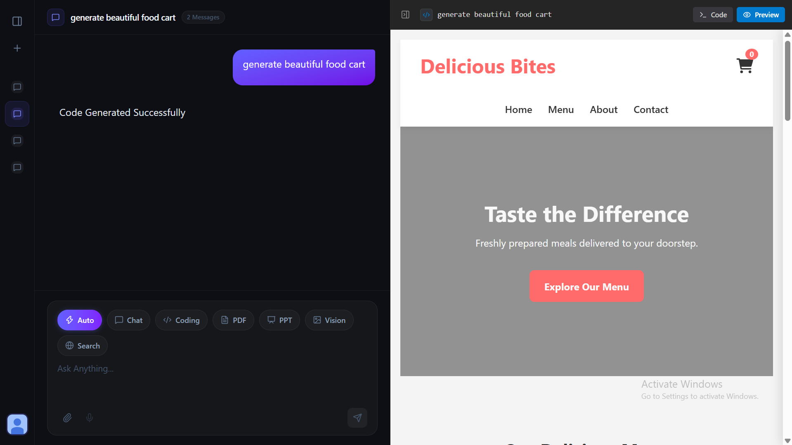
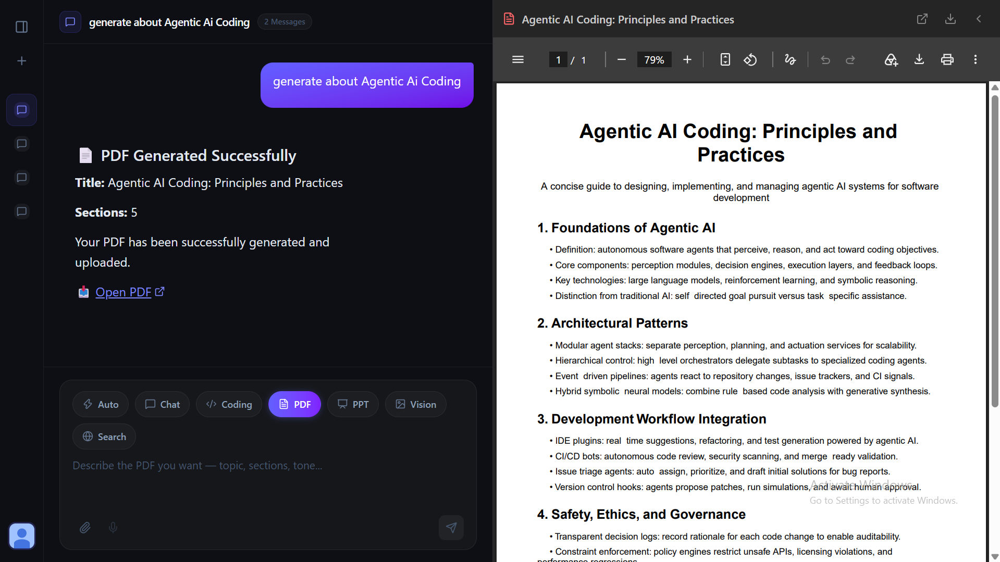
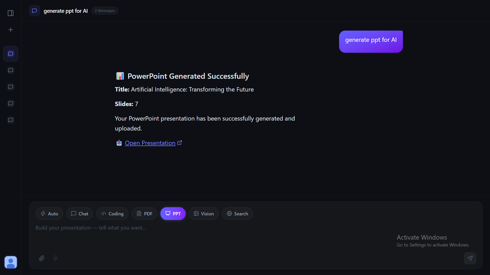
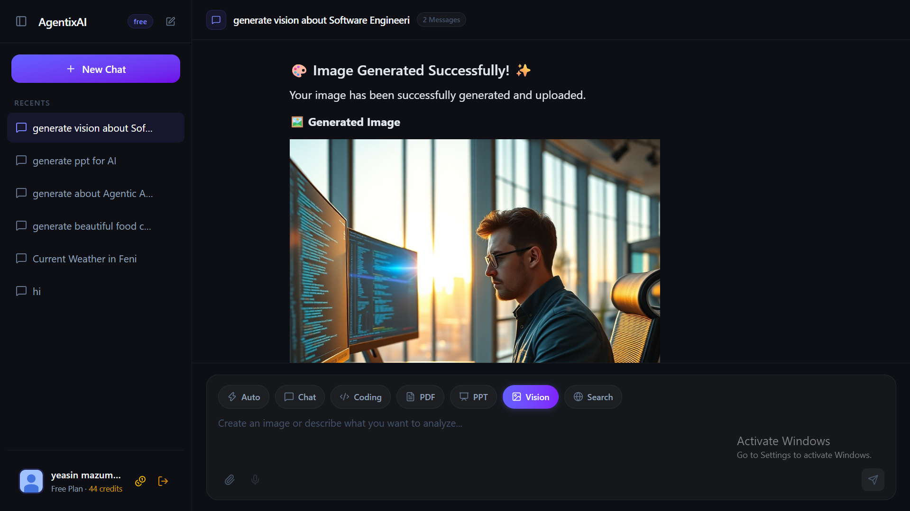
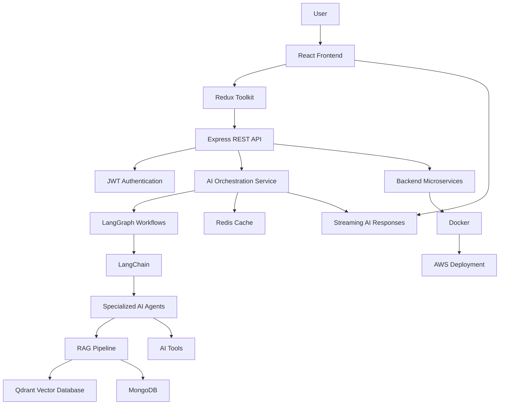
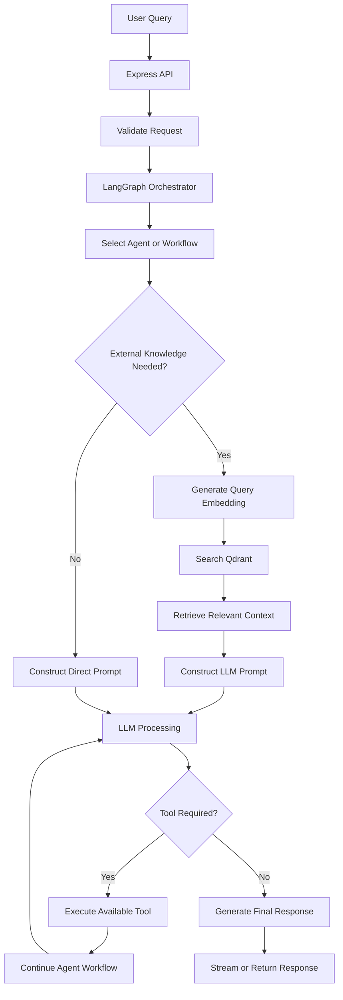

# 🚀 AgentixAI — Production-Ready Multi-Agent AI Platform

### Building Intelligent AI Applications with MERN, LangGraph, RAG, Microservices & AWS

**AgentixAI** is a powerful, scalable, and production-oriented Multi-Agent AI platform that combines the MERN stack with modern AI technologies to build intelligent applications. It brings together AI agents, retrieval-augmented generation (RAG), vector search, document processing, and distributed backend services in a unified architecture.

Designed with scalability, maintainability, and real-world application development in mind, AgentixAI demonstrates how modern web technologies and agentic AI workflows can work together to create intelligent, context-aware applications.

Whether you're building an AI SaaS product, developing enterprise AI solutions, preparing for backend engineering interviews, or strengthening your portfolio, AgentixAI provides a foundation for exploring modern AI application architecture.

---

## 📸 Screenshots

### 🏠 Search Agent


### 🏠 Coding Agent


### ⚙️ Coding Preview


### ⚙️ PDF Generation


### ⚙️ PPT Generation


### ⚙️ Vision Generation


---

## ✨ Key Features

- 🤖 **Multi-Agent AI System** — Build intelligent agents that collaborate to handle complex tasks.
- 🧠 **LangGraph Workflows** — Orchestrate stateful, multi-step AI workflows with structured execution.
- 🔗 **LangChain Integration** — Connect language models, tools, prompts, and external data sources.
- 📚 **Retrieval-Augmented Generation (RAG)** — Generate context-aware responses using relevant external knowledge.
- 🔍 **Qdrant Vector Database** — Store and retrieve vector embeddings for semantic search.
- ⚡ **Redis Caching** — Reduce repeated computation and improve response performance.
- 🌐 **MERN Stack** — Build a complete full-stack application with MongoDB, Express.js, React, and Node.js.
- 🔐 **JWT Authentication** — Secure API access and authenticated user workflows.
- 📄 **Document Processing** — Upload, process, and retrieve information from documents.
- 🛠️ **AI Tool Calling** — Enable agents to interact with tools and external services.
- 📡 **Streaming AI Responses** — Deliver generated responses incrementally for a responsive user experience.
- 🔄 **Redux Toolkit** — Manage frontend application state and AI conversation data.
- 🔌 **RESTful APIs** — Expose structured endpoints for frontend and service communication.
- 🧩 **Microservices Architecture** — Organize application responsibilities into modular, independently manageable services.
- 🐳 **Docker Containerization** — Package application components into reproducible environments.
- ☁️ **AWS Deployment** — Support cloud deployment and scalable infrastructure design.
- 🏗️ **Scalable Project Structure** — Maintain clear separation of concerns and reusable modules.
- ✅ **Production-Oriented Practices** — Emphasize validation, error handling, security, maintainability, and performance.

---

## 🛠️ Technology Stack

### Frontend

| Technology | Purpose |
|---|---|
| React.js | Component-based user interface |
| Redux Toolkit | Global state management |
| JavaScript / TypeScript | Application development |
| REST API Integration | Communication with backend services |

### Backend

| Technology | Purpose |
|---|---|
| Node.js | JavaScript runtime |
| Express.js | API development and middleware |
| MongoDB | Persistent application data |
| JWT | Authentication and authorization |
| REST APIs | Communication between clients and services |

### AI & Agent Engineering

| Technology | Purpose |
|---|---|
| LangChain | LLM integrations, prompts, and tools |
| LangGraph | Stateful agent workflow orchestration |
| Multi-Agent Architecture | Coordinating specialized AI agents |
| RAG | Context-aware knowledge retrieval |
| AI Tool Calling | Executing supported tools through AI workflows |
| Streaming | Incremental AI response delivery |

### Data & Infrastructure

| Technology | Purpose |
|---|---|
| Qdrant | Vector storage and semantic retrieval |
| Redis | Caching and fast data access |
| Docker | Containerization |
| AWS | Cloud infrastructure and deployment |
| Microservices | Modular service architecture |

---

## 🏛️ System Architecture

AgentixAI combines a modern web application with AI orchestration, retrieval infrastructure, and deployment services.



### 📐 Interactive Architecture Diagram (Excalidraw)
View and edit the full system architecture diagram on Excalidraw:

- [AgentixAI Architecture] — (https://excalidraw.com/#json=r6Ru2Np5cwntFmFwX-kyV,hHgTxeskdiwLsBaaIPoUQA)

The Excalidraw board provides an interactive, editable view of the full AgentixAI system architecture — including the frontend, API layer, AI orchestration, agent layer, RAG pipeline, vector database, caching, microservices, Docker, and AWS deployment. You can pan, zoom, and modify the diagram directly in your browser.

### Architecture Overview

1. **Frontend Layer:** React provides the user interface, while Redux Toolkit manages application state.
2. **API Layer:** Express.js exposes REST endpoints and handles requests, validation, and authentication.
3. **AI Orchestration Layer:** LangGraph coordinates agent execution and multi-step workflows.
4. **Agent Layer:** Specialized agents process requests and use supported tools when needed.
5. **Knowledge Layer:** The RAG pipeline retrieves relevant information from Qdrant and combines it with user queries.
6. **Data Layer:** MongoDB stores persistent application data, while Redis supports caching.
7. **Infrastructure Layer:** Docker packages services, and AWS provides cloud deployment infrastructure.

*The diagram represents the intended high-level architecture. Actual service boundaries and integrations depend on the implemented modules.*

---

## 🧠 How the AI Pipeline Works

A typical AI request can follow this workflow:



**Important:** The exact execution path depends on the request. Not every query requires vector retrieval or tool execution.

---

## 📚 Understanding the Core Concepts

### 1. Multi-Agent AI

A multi-agent system divides complex tasks among specialized AI agents. Each agent can have a defined responsibility, supported tools, and a specific role in the overall workflow.

Potential responsibilities include:

- General question answering
- Document analysis
- Knowledge retrieval
- Tool-assisted research
- Task planning and execution

### 2. LangGraph

LangGraph provides graph-based orchestration for stateful AI applications. It allows developers to define nodes, transitions, shared state, conditional routing, and iterative workflows.

### 3. Retrieval-Augmented Generation (RAG)

RAG grounds language-model responses in retrieved information rather than relying exclusively on the model's internal knowledge.

A typical RAG pipeline:

1. Ingest documents.
2. Split documents into manageable chunks.
3. Generate embeddings.
4. Store embeddings and associated metadata in Qdrant.
5. Convert a user query into an embedding.
6. Retrieve relevant document chunks.
7. Add the retrieved context to the prompt.
8. Generate a context-aware response.

### 4. Vector Search with Qdrant

Qdrant stores vector embeddings and supports similarity-based retrieval. It helps applications find semantically relevant content even when the wording differs from the original document.

### 5. Redis Caching

Redis can cache frequently requested data or suitable AI results. Effective caching requires appropriate expiration policies, invalidation strategies, and care around user-specific information.

### 6. Microservices Architecture

Microservices organize a system into smaller services with clearly defined responsibilities and interfaces. This can improve independent deployment and scaling, although it also introduces operational complexity.

---

## 🔒 Security & Reliability

A production-oriented AI platform should account for security and operational reliability throughout its lifecycle.

- JWT-based authentication and appropriate authorization checks.
- Request validation and consistent error handling.
- Secure environment-variable and secret management.
- File type, file size, and upload validation.
- Protection against prompt injection and unsafe tool execution.
- Access control for retrieved documents and user-specific context.
- Rate limiting and resource usage controls.
- Safe handling of model errors, timeouts, and external API failures.
- Appropriate logging, monitoring, and health checks.
- Docker image and dependency security.
- Payment and other sensitive operations validated on the server when applicable.

These are engineering considerations for the platform; individual controls should be verified against the actual implementation.

---

## 📁 Suggested Project Structure

The following structure illustrates one possible organization for a MERN-based multi-agent application. Adapt it to the services and modules actually present in your repository.

```text
agentixAI/
├── frontend/
│   ├── public/
│   └── src/
│       ├── components/
│       ├── features/
│       ├── hooks/
│       ├── pages/
│       ├── services/
│       ├── store/
│       └── utils/
│
├── backend/
│   ├── src/
│   │   ├── config/
│   │   ├── controllers/
│   │   ├── middlewares/
│   │   ├── models/
│   │   ├── routes/
│   │   ├── services/
│   │   ├── utils/
│   │   └── server.js
│   └── package.json
│
├── ai-services/
│   ├── agents/
│   ├── graphs/
│   ├── rag/
│   ├── tools/
│   ├── embeddings/
│   └── document-processing/
│
├── infrastructure/
│   ├── docker/
│   └── aws/
│
├── docker-compose.yml
├── .env.example
└── README.md
```

---

## ⚙️ Getting Started

### Prerequisites

Install the tools and services required by the modules you intend to run:

- [Node.js](https://nodejs.org/)
- [MongoDB](https://www.mongodb.com/)
- [Redis](https://redis.io/)
- [Qdrant](https://qdrant.tech/)
- Docker and Docker Compose
- An API key for your selected language model provider

Python and other runtimes may also be required if AI services are implemented separately from the Node.js backend.

### Installation

Clone the repository:

```bash
git clone https://github.com/yeasin-riyad/Multi-Agent-Ai-Platform-Monolithic-Architecture-frontend.git
cd Multi-Agent-Ai-Platform-Monolithic-Architecture-frontend
```

Install dependencies for the frontend and backend using the package manager and directory structure configured in your repository.

For example, if both directories contain their own `package.json` files:

```bash
cd frontend
npm install

cd ../backend
npm install
```

Install dependencies for any separately implemented AI service using its own dependency manager.

### Environment Variables

Create environment files based on your application's configuration. For example:

```env
# Application
NODE_ENV=development
PORT=5000
CLIENT_URL=http://localhost:3000

# Database
MONGODB_URI=mongodb://localhost:27017/agentixai

# Authentication
JWT_SECRET=replace_with_a_secure_random_secret
JWT_EXPIRES_IN=15m

# AI Provider
LLM_API_KEY=your_llm_api_key
LLM_MODEL=your_model_name

# Vector Database
QDRANT_URL=http://localhost:6333
QDRANT_API_KEY=

# Cache
REDIS_URL=redis://localhost:6379
```

Use the actual variable names expected by your application. These names are illustrative, not a guarantee of your current configuration.

**Security:** Never commit real API keys, database credentials, JWT secrets, or production environment files to GitHub.

### Run the Application

Start MongoDB, Redis, Qdrant, and any other required infrastructure services.

Then start the frontend, backend, and AI services using the scripts defined in their respective package files.

For a containerized environment, use the configured Docker Compose file if your repository includes a working setup:

```bash
docker compose up --build
```

The exact startup commands and local URLs depend on your project's configuration.

---

## 🐳 Docker & ☁️ AWS Deployment

Docker provides a consistent environment for packaging application components and their dependencies.

A deployment workflow may include:

1. Create production-ready application builds.
2. Build and tag Docker images.
3. Configure environment variables and secrets.
4. Push images to a container registry such as Amazon ECR.
5. Deploy services using an appropriate AWS compute platform.
6. Configure networking, HTTPS, and domain routing.
7. Set up managed databases and caching where appropriate.
8. Add health checks, logs, metrics, and alerting.
9. Configure backups, scaling, and recovery procedures.

Possible AWS services include:

- **Amazon ECS / AWS Fargate** — containerized application workloads.
- **Amazon ECR** — container image storage.
- **Amazon EC2** — virtual machines for application hosting.
- **Amazon CloudWatch** — logs, metrics, and monitoring.
- **Application Load Balancer** — traffic distribution.
- **AWS Secrets Manager** — protected secret storage.

Choose services based on the application's actual traffic, reliability requirements, and operational budget.

---

## ⚡ Performance & Scalability

Important performance strategies for an AI application include:

- Cache suitable, frequently requested data with Redis.
- Use efficient database queries and appropriate indexes.
- Limit document chunk sizes and retrieve only relevant context.
- Stream AI responses where supported.
- Set timeouts and retry policies for external services.
- Apply request rate limits and concurrency controls.
- Process expensive document-ingestion tasks asynchronously when needed.
- Track model latency, token usage, and retrieval quality.
- Scale independent services according to their workload.

AI performance depends on more than server response time. Model latency, embedding generation, vector retrieval, network requests, and tool execution can all contribute to end-to-end response time.

---

## 🧪 Testing & Quality

A reliable implementation should include tests at multiple levels:

- **Unit tests:** Validate individual functions, services, and agent nodes.
- **Integration tests:** Verify API endpoints, database access, and service interactions.
- **Workflow tests:** Check graph transitions, tool execution, and failure handling.
- **RAG evaluation:** Measure retrieval relevance, grounding, and answer quality.
- **Security tests:** Validate authentication, authorization, uploads, and tool permissions.
- **Load tests:** Evaluate API capacity, concurrency, and AI-service limits.

Use the test frameworks and commands configured in the repository.

---

## 🗺️ Development Roadmap

Potential future enhancements include:

- [ ] Expand specialized agent capabilities.
- [ ] Add human approval for sensitive tool actions.
- [ ] Improve RAG with metadata filtering and reranking.
- [ ] Add document-source citations in generated answers.
- [ ] Introduce asynchronous document processing.
- [ ] Add conversation persistence and retrieval.
- [ ] Implement comprehensive observability.
- [ ] Improve automated AI evaluation.
- [ ] Add CI/CD pipelines.
- [ ] Automate cloud deployment and infrastructure provisioning.
- [ ] Add production load testing and cost monitoring.

This roadmap represents possible enhancements, not a claim that these features are already implemented.

---

## 🎯 Why AgentixAI?

AgentixAI brings together several important areas of modern software engineering:

- Full-stack web application development with the MERN stack.
- AI agent orchestration with LangGraph and LangChain.
- Retrieval-augmented generation and vector search.
- Authentication, API design, and data management.
- Caching, service boundaries, and scalability.
- Containerization and cloud deployment.
- Security, testing, and production-oriented engineering.

The goal is to demonstrate how these technologies fit together in a maintainable, extensible AI application architecture.

---

## 🤝 Contributing

Contributions, suggestions, and improvements are welcome.

1. Fork the repository.
2. Create a feature branch.
3. Implement your changes.
4. Run relevant tests.
5. Submit a pull request with a clear description of the changes.

Please keep contributions focused, documented, and consistent with the project's existing architecture.

---

## 👨‍💻 Author

**Yeasin Riyad**

Creator of **AgentixAI** — exploring full-stack engineering, agentic AI, RAG, and scalable software architecture.

- GitHub: [@yeasin-riyad](https://github.com/yeasin-riyad)

---

## 📄 License

Add a `LICENSE` file to specify the terms under which this project may be used, modified, and distributed.

---

<p align="center">
  <strong>🚀 Building the next generation of intelligent applications with AgentixAI.</strong>
</p>

<p align="center">
  MERN Stack • Multi-Agent AI • LangGraph • RAG • Qdrant • Redis • Docker • AWS
</p>
